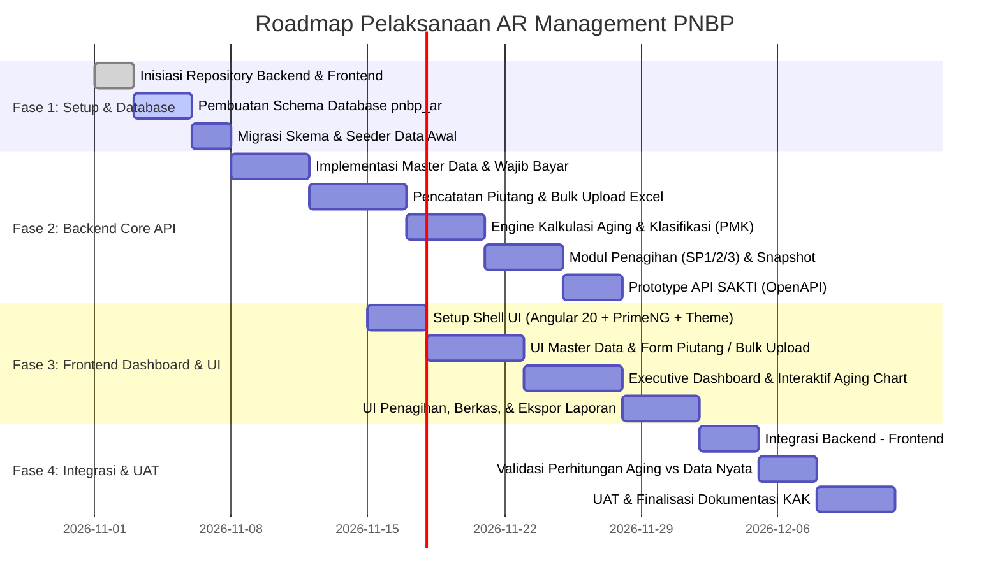

# RENCANA PENGEMBANGAN SISTEM AR MANAGEMENT PNBP
## (Accounts Receivable Management Enhancement - Lingkup KLH/BPLH 2026)

---

## 1. Ringkasan Eksekutif & Keselarasan Arsitektur

Berdasarkan Kerangka Acuan Kerja (KAK) dan Proposal Teknis, sistem ini dirancang sebagai subsistem terpisah (**Standalone Subsystem**) yang berfokus penuh pada **Pengelolaan Piutang Negara (Accounts Receivable Management)** untuk Penerimaan Negara Bukan Pajak (PNBP) di lingkungan Kementerian Lingkungan Hidup / Badan Pengendalian Lingkungan Hidup (KLH/BPLH).

### Prinsip Arsitektur yang Disepakati:
1. **Teknologi Selaras dengan Sistem Eksisting (`pnbp2`)**:
   - **Frontend**: **Angular 20** + **PrimeNG 20** + **TailwindCSS** + **Chart.js / ngx-echarts** (kompatibel penuh dengan layout, komponen, dan standar pnbp2).
   - **Backend**: **ASP.NET Core Web API (.NET 8.0)** dengan pola Clean Architecture / Modular Service.
2. **Database Development (`109.123.235.50`)**:
   - Database Engine: **MySQL / MariaDB**.
   - Skema Baru: `pnbp_ar` (terpisah dari skema operasional `pnbp_stg` atau database utama pnbp).
   - Memungkinkan pembacaan (*cross-schema read-only queries*) ke tabel transaksi/billing pnbp eksisting tanpa membebani atau mengganggu proses transaksi aktif.
3. **Desain Antarmuka & Nuansa Visual**:
   - **Layout dasar**: Struktur layout disamakan dengan sistem PNBP eksisting (`Header`, `Sidebar`, `Breadcrumb`, `Dynamic Filter`, dialog & tabel PrimeNG).
   - **Pembeda Nuansa / Tema Visual**:
     - Sistem PNBP Umum: Dominan nuansa *Forest/Emerald Green* (identitas Lingkungan Hidup).
     - **AR Management**: Nuansa **Deep Navy & Slate Blue** dengan aksen **Amber/Gold & Crimson** untuk menandai status keuangan, jatuh tempo (*due date*), risiko penagihan, dan matriks *aging* piutang negara.

---

## 2. Struktur Modul & Fitur yang Dibutuhkan

Berdasarkan KAK 2026 dan PMK No. 163/PMK.06/2020 jo. PMK 150/PMK.06/2022, berikut adalah rincian modul yang akan dibangun:

```
┌────────────────────────────────────────────────────────────────────────┐
│                   AR MANAGEMENT PNBP (APLIKASI BARU)                   │
├────────────────────────────────────────────────────────────────────────┤
│ 1. Modul Dashboard Eksekutif & Analitik Aging                          │
│ 2. Modul Master Data Piutang & Wajib Bayar                             │
│ 3. Modul Pencatatan & Buku Pembantu Piutang (AR Ledger)                │
│ 4. Modul Mesin Kalkulasi Aging & Klasifikasi Kualitas Piutang (PMK 163) │
│ 5. Modul Tindak Lanjut Penagihan & Surat Peringatan (SP 1, 2, 3, PUPN) │
│ 6. Modul Pelaporan Keuangan & Ekspor (Excel / PDF)                     │
│ 7. Modul Integrasi (Sinkronisasi SIMPONI & Prototype API SAKTI)        │
│ 8. Modul Administrasi, Hak Akses Berjenjang (RBAC) & Audit Trail       │
└────────────────────────────────────────────────────────────────────────┘
```

### Modul 1: Dashboard Eksekutif & Analitik Piutang Nasional
* **Kartu Ringkasan Metrik (KPI Cards)**: Total Piutang Bruto, Total Piutang Tertagih/Lunas, Piutang Jatuh Tempo, Rasio Penyelesaian (*Recovery Rate*), Total Penyisihan Piutang Tak Tertagih.
* **Matriks Visualisasi Aging Schedule**: Grafik batang interaktif komposisi umur piutang (*Current*, 1–30 hr, 31–90 hr, 91–180 hr, 181–365 hr, >365 hr).
* **Komposisi Kualitas Piutang (Donut Chart)**: Persentase Lancar, Kurang Lancar, Diragukan, Macet.
* **Fitur Drill-Down Interaktif**:
  - Klik Satker $\rightarrow$ Lihat daftar Wajib Bayar di Satker tersebut $\rightarrow$ Lihat rincian Dokumen Penetapan & surat tagihan.
* **Filter Global Cepat**: Filter berdasarkan Tahun Buku, Satker (15 Satker Prioritas), Jenis PNBP, dan Status Kualitas.

### Modul 2: Master Data Piutang & Wajib Bayar
* **Master Wajib Bayar**: NPWP, NIK, Nama Perusahaan/Individu, Alamat, Kontak/PIC, Klasifikasi Usaha, deteksi duplikasi.
* **Master 15 Satker Prioritas**: Kode Satker Kemenkeu, Nama Satker, Unit Eselon, Penanggung Jawab Keuangan Satker.
* **Master Referensi Tarif & Objek PNBP**: Terhubung dengan klasifikasi akun PNBP bidang lingkungan hidup.
* **Master Dokumen Dasar Penetapan**: Jenis dasar penetapan (SK Penetapan PNBP, SK Tuntutan Ganti Rugi, Denda Keterlambatan, Putusan Pengadilan, Rekomendasi BPK, dsb.).

### Modul 3: Pencatatan Piutang & AR Ledger (Buku Besar Pembantu)
* **Perekaman Piutang Baru**: Nomor Dokumen Penetapan, Tanggal Penetapan, Tanggal Jatuh Tempo, Satker Pemilik, Nilai Pokok Piutang, Nilai Bunga/Denda.
* **Fitur Bulk Upload Excel (Migrasi Spreadsheet Satker)**:
  - Format template Excel terstandar yang dilengkapi validasi rumus.
  - Parser backend yang memvalidasi baris demi baris sebelum disimpan (validasi format NPWP, tanggal, nilai numerik, kode satker).
  - Laporan hasil impor: baris mana yang berhasil dan baris mana yang gagal beserta alasannya.
* **Pencatatan Pembayaran / Pelunasan**:
  - Pelunasan penuh maupun bertahap (angsuran).
  - Input NTPN (Nomor Transaksi Penerimaan Negara), Nomor Kode Billing SIMPONI, Tanggal Bayar, dan Bank Persepsi.
* **Penyesuaian & Koreksi Piutang**: Mekanisme koreksi nilai piutang dengan persetujuan berjenjang (*workflow approval*) dan pencatatan alasan (*audit reason*).

### Modul 4: Mesin Kalkulasi Aging & Klasifikasi Kualitas (PMK 163/2020)
* **Kalkulasi Umur Otomatis**: Menghitung selisih hari antara tanggal jatuh tempo dengan tanggal batas perhitungan (dinamis atau per cut-off).
* **Klasifikasi Kualitas Piutang Negara**:
  1. **Lancar**: Belum jatuh tempo s.d. 1 bulan sejak jatuh tempo.
  2. **Kurang Lancar**: Jatuh tempo > 1 bulan s.d. 3 bulan setelah SP I diterbitkan.
  3. **Diragukan**: Telah diterbitkan SP II / belum dilunasi > 3 bulan s.d. 12 bulan.
  4. **Macet**: Telah diserahkan pengurusannya ke PUPN atau > 12 bulan tanpa pelunasan.
* **Simulasi & Snapshot Periodik**: Fitur *freeze snapshot* data piutang per akhir bulan/semester/tahunan agar laporan keuangan historis tidak berubah saat ada mutasi baru.

### Modul 5: Monitoring Penagihan & Tindak Lanjut
* **Perekaman Progres Tindak Lanjut Penagihan**:
  - Penerbitan Surat Tagihan I (SP I).
  - Penerbitan Surat Peringatan II (SP II).
  - Penerbitan Surat Peringatan III (SP III).
  - Berita Acara Pertemuan / Klarifikasi / Pengakuan Hutang.
* **Penanganan Status Khusus**:
  - Pengajuan Keberatan / Permohonan Keringanan.
  - Perjanjian Angsuran (Jadwal cicilan & pemantauan pembayaran cicilan).
  - Proses Pelimpahan Pengurusan ke **PUPN (Panitia Urusan Piutang Negara) / DJKN**.
* **Manajemen Berkas Digital**: Unggah salinan surat tagihan, tanda terima surat, dan dokumen pendukung (PDF/gambar).
* **Early Warning System**: Notifikasi piutang yang H-30, H-7, atau telah melewati jatuh tempo.

### Modul 6: Pelaporan Keuangan & Ekspor Data
* **Laporan Mutasi Piutang**: Saldo Awal, Penambahan Piutang Baru, Pengurangan (Pelunasan/Koreksi), dan Saldo Akhir.
* **Laporan Daftar Rincian Umur Piutang (Aging Schedule Report)** format standar Kementerian Keuangan.
* **Laporan Kualitas Piutang & Estimasi Penyisihan**.
* **Ekspor Berkas**: Generator **Excel (.xlsx)** terformat rapi dan **PDF Siap Cetak**.

### Modul 7: Layanan Integrasi (API Bridge SIMPONI & Prototype SAKTI)
* **Konektor Pembayaran SIMPONI**: Pengecekan otomatis status billing di sistem PNBP eksisting untuk rekonsiliasi otomatis pelunasan piutang.
* **Prototype Web Service SAKTI (OpenAPI 3.0)**:
  - Endpoint REST API penyedia data piutang untuk modul SAKTI Piutang / General Ledger.
  - Skema data terstandar sesuai kamus data SAKTI Kemenkeu (Kode Satker, Akun 115xxx, Nilai Piutang, Tanggal Transaksi).
  - Mekanisme keamanan API Token (Bearer JWT / API Key) dan audit logging setiap akses API.

### Modul 8: Manajemen Pengguna & Keamanan (RBAC)
* **Pembagian Peran (Role-Based Access)**:
  1. *Super Admin (Pusdatin)*: Konfigurasi teknis, manajemen user, log sistem.
  2. *Pengelola Pusat (Biro Renkeu)*: Akses penuh data 15 Satker nasional, approval koreksi, laporan nasional.
  3. *Operator Satker (15 Satker)*: Input penetapan, upload Excel satker, update status penagihan satker (terisolasi hanya satkernya sendiri).
  4. *Auditor / Pimpinan*: Hak akses *Read-Only* untuk pemantauan dashboard eksekutif dan unduh laporan.
* **Audit Trail**: Pencatatan siapa, kapan, IP mana, dan riwayat data sebelum vs sesudah perubahan (*immutable log*).

---

## 3. Desain Skema Database (`109.123.235.50` - `pnbp_ar`)

Pada server MySQL `109.123.235.50`, kita akan membuat database/skema baru `pnbp_ar`.

```
pnbp_ar
 ├── ar_wajib_bayar                 (Master Wajib Bayar / Debitur)
 ├── ar_satker                      (15 Satker Prioritas & Penanggung Jawab)
 ├── ar_jenis_pnbp                  (Referensi Jenis PNBP & Akun Akuntansi)
 ├── ar_piutang                     (Tabel Utama Ketetapan Piutang)
 ├── ar_piutang_histori             (Log Perubahan & Penyesuaian Saldo Piutang)
 ├── ar_pembayaran                  (Riwayat Pembayaran/Pelunasan, NTPN, Billing)
 ├── ar_jadwal_angsuran             (Jika terdapat restrukturisasi/cicilan)
 ├── ar_penagihan_log               (Riwayat SP 1, SP 2, SP 3, Somasi, dsb.)
 ├── ar_penagihan_dokumen           (Lampiran PDF surat teguran & berita acara)
 ├── ar_kualitas_aging              (Konfigurasi parameter batas hari & kualitas)
 ├── ar_snapshot_periodik           (Snapshot saldo piutang akhir bulan/tahun)
 ├── ar_upload_batch                (Riwayat unggah massal Excel dari Satker)
 ├── ar_upload_batch_detail         (Log baris validasi sukses / gagal)
 ├── ar_sakti_export_log            (Log pertukaran data ke SAKTI)
 └── ar_audit_logs                  (Log aktivitas pengguna)
```

---

## 4. Tahapan Pelaksanaan & Roadmap Pengembangan



---

## 5. Pertanyaan & Poin Konfirmasi untuk Diskusi

Sebelum kita mulai pembuatan scaffolding proyek (backend & frontend):

1. **Akses Database Development (`109.123.235.50`)**:
   - Port koneksi: apakah standar MySQL `3306`?
   - Kredensial user (username & password) untuk membuat database `pnbp_ar` dan mengeksekusi migration script.
2. **Karakter Nuansa Warna Frontend**:
   - Apakah Anda setuju dengan palet warna **Financial Deep Navy / Royal Indigo** dipadu dengan aksen **Amber & Gold** (sebagai indikator aging & status jatuh tempo), dengan struktur sidebar/header persis seperti PNBP?
3. **Template Excel Satker**:
   - Apakah sudah ada contoh format spreadsheet piutang dari salah satu satker yang sering digunakan, atau kita siapkan template baku sesuai atribut KAK?
